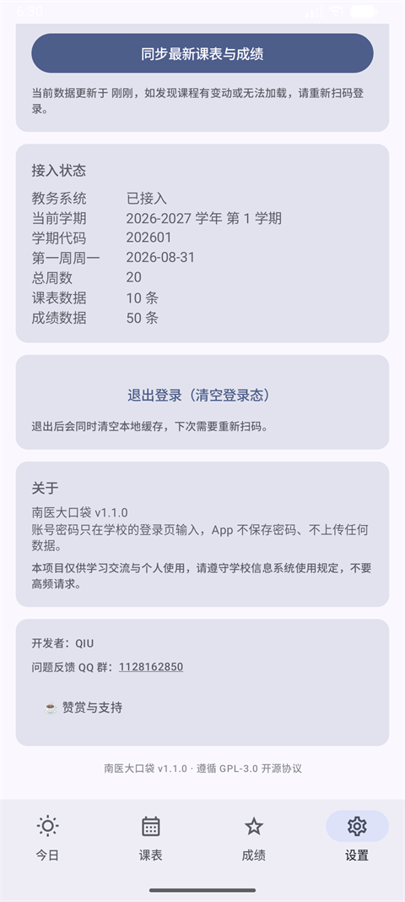

<div align="center">

# 南医大口袋 · SMU Pocket

南方医科大学学生自用的 Android 客户端

**课表 · 成绩 · 考试网考号 · 离线可用 · 深色模式**


</div>

> **非官方项目。** 与南方医科大学无任何隶属关系，未获学校授权或认可。
> 数据直连学校系统，不经过任何第三方服务器；**只读不写**，不做选课、缴费、评教提交等任何写操作。

---

## 功能

| 页面 | 能力 |
|---|---|
| **今日** | 日期标题 · 今日课程 · 明日课程 · 本周概览柱状图 · 考试安排（含**网考号**、共 N 场） |
| **课表** | **固定 14 节网格（含 11~14 节晚课）** · 按周切换 · 教务原生配色 · 跨节课程合并成整块 · 自主学习标注 |
| **成绩** | 按学期折叠 · 加权绩点 / 加权平均 / 总学分 / 门数 |
| **设置** | 手动同步 · 接入状态 · 开发者与反馈（QQ 群一键复制）· ☕ 赞赏与支持 · 版本与开源信息 |

**深色模式**：跟随系统深浅色；Android 12+ 默认取壁纸动态配色（Material You），不喜欢可关。

### 细节

- **扫码登录** —— 在 WebView 里打开学校登录页，用户自己扫码；App 不接触密码，只接管登录成功后的 cookie
- **固定 14 节** —— 网格和左侧节次列永远渲染 1~14 行，即使某周没有晚课也保留空行；晚课不再「凭空消失」
- **今日与课表解耦** —— 在课表翻到第 8 周，「今日」仍然是**真实当前周**的课
- **明日课程** —— 自动处理跨周（今天是周日时，明天属于下一周，会单独拉取）
- **自主学习** —— 教务 `jxhjmc` 为「自主学习」的课打绿色标签，教室显示为「无需前往教室」
- **考试网考号** —— 从 `xskcrw/skrwDatas` 取「网考号」，按课程名匹配后以灰色小字追加：`药理学 [网考号：13621854]`
- **考试一场不落** —— 未来考试全部按日期升序显示（标题显示总场数），不会因为条数上限被截断
- **加载不闪** —— 网考号与考试列表在**同一帧**出现，不会「列表先出、号码过一秒再跳出来」
- **离线可用** —— 每次加载成功后缓存课表、成绩与考试；登录过期时继续显示缓存，设置页可手动同步

---

## 截图

<div align="center">



</div>

> 截图使用的是**演示数据**（登录页 →「先用演示数据看看」），不代表真实课表。

---

## 下载与安装

从 [Releases](https://github.com/1812355417/smu-pocket/releases) 下载最新 `smu-pocket-v1.1.0.apk`，传到手机点击安装即可（需允许「未知来源」）。

- **从 debug 版升级**：debug 包和正式包签名不同，需要先卸载旧版（本地缓存会清空，登录态需重新扫码）
- **正式包校验**：与 Release 页面附带的 SHA-256 比对，确认下载完整

```bash
adb install -r smu-pocket-v1.1.0.apk
```

---

## 技术栈

| 层 | 选型 | 说明 |
|---|---|---|
| 语言 | **Kotlin 2.0.21** | 协程 + 扩展函数 |
| UI | **Jetpack Compose** (BOM 2024.12.01) | Material3，无 XML 布局，支持深色 / 动态取色 |
| 状态 | `ViewModel` + `StateFlow` | 单一 `AppViewModel` 持有全部状态 |
| 网络 | **OkHttp 4.12** + **Retrofit 2.11** | 响应统一用 `ResponseBody` 接，手动解析 |
| 序列化 | **kotlinx.serialization 1.7.3** | 自定义 `FlexibleStringSerializer` 兼容类型漂移 |
| 登录 | `WebView` + `CookieManager` | 不接触密码，只采集 cookie |
| 构建 | Gradle 8.9 · AGP 8.7.3 · JDK 17 | `compileSdk 35` / `minSdk 26` / `targetSdk 35` |
| 压缩 | **R8**（`isMinifyEnabled = true`） | debug ~17 MB → release **1.7 MB** |
| 测试 | JUnit 4 | **66 个单测**，跑夹具不需网络 |

**刻意的取舍**：不引 Hilt/Koin、不引 Room、不引 Navigation 库。整个 App 就两三个对象，
手写容器（`AppContainer`）比引框架便宜；接口改版时只改 `data/model/Mappers.kt` 一个文件。

---

## 快速开始

### 环境要求

- **JDK 17**（AGP 8.7 不支持 JDK 21+，用 25 会直接报错）
- **Android SDK Platform 35** + Build-Tools 35
- Android Studio Ladybug 及以上（可选，命令行也能构建）

### 1. 克隆

```bash
git clone https://github.com/1812355417/smu-pocket.git
cd smu-pocket
```

### 2. 指向你的 SDK

根目录建 `local.properties`（已在 `.gitignore` 里，不会提交）：

```properties
sdk.dir=C\:\\Users\\你的用户名\\AppData\\Local\\Android\\Sdk
```

> macOS / Linux 写 `sdk.dir=/Users/你的用户名/Library/Android/sdk`

### 3. ⚠️ 删掉机器相关的 JDK 路径

`gradle.properties` 里可能有一行：

```properties
org.gradle.java.home=C:/path/to/your/jdk-17
```

**那是原作者机器上的绝对路径，你必须删掉或改成自己的**，否则构建会失败（路径不存在）。

删掉后如果 Android Studio 报 JDK 版本错误，说明它在用自带的 JBR：
去 `Settings → Build, Execution, Deployment → Build Tools → Gradle → Gradle JDK`，选一个 **17**。

### 4. 构建

```bash
# 单元测试（不需要真机，66 个用例）
./gradlew testDebugUnitTest

# 调试包 → app/build/outputs/apk/debug/app-debug.apk
./gradlew assembleDebug

# 正式包（已开 R8）→ app/build/outputs/apk/release/app-release.apk
./gradlew assembleRelease
```

Windows 用 `gradlew.bat`。首次构建会从**腾讯云镜像**下载 Gradle 8.9。

> 也可以直接 `git clone` 后用 Android Studio `File → Open` 打开，它会自动补全 SDK 与 Gradle。

### 5. 正式签名（可选）

没有 `keystore.properties` 时，`assembleRelease` 产出的是**未签名** APK（无法直接安装）。
想打可安装的正式包，在项目根目录建 `keystore.properties`（已在 `.gitignore` 里）：

```properties
storeFile=C:/path/to/your.jks
storePassword=******
keyAlias=your_alias
keyPassword=******
```

然后 `./gradlew assembleRelease` 会直接产出**已签名**的 `app-release.apk`。

> **keystore 丢了就永远无法给已安装用户推送更新**，这是 Android 签名的硬规则，务必离线备份。
> 换签名后的包必须让用户卸载重装。

---

## 项目结构

```
smu-pocket/
├─ app/src/main/java/com/smu/pocket/
│  ├─ App.kt             手写依赖容器
│  ├─ MainActivity.kt    Compose 入口
│  ├─ core/              领域模型、时间/周次工具、会话与缓存
│  │  ├─ Models.kt       Course / Grade / TimetableConfig / TOTAL_SECTIONS
│  │  ├─ Periods.kt      作息表（1~14 节，唯一一份，RealJw 与 FakeJw 共用）
│  │  ├─ TimeUtils.kt    周次换算、日期推算、节次解析
│  │  ├─ Semester.kt     第一周周一 → 第几周
│  │  ├─ Session.kt      cookie 按 host 持久化
│  │  └─ CacheStore.kt   课表/成绩/考试的本地快照（旧缓存自动补全作息）
│  ├─ data/              教务接口
│  │  ├─ JwApi.kt        Retrofit 接口定义（课表 / 成绩 / 网考号）
│  │  ├─ RealJw.kt       真实实现：自举 + 按周拉取 + 分页成绩 + 网考号缓存
│  │  └─ model/          JSON 模型、柔性序列化器、映射
│  └─ ui/                今日 / 课表 / 成绩 / 设置 / 登录
├─ app/src/test/         66 个单测 + 6 份脱敏夹具
├─ docs/
│  ├─ architecture.md    架构与关键机制
│  ├─ capture-checklist.md  抓包清单（接口调研的起点）
│  └─ screenshots/       README 截图（演示数据）
└─ smu-probe/            教务 / 电费接口规格、字段字典
```

---

## 几个关键设计

### 登录为什么放在 WebView 里

`LoginScreen` 只做一件事：打开学校自己的登录页，用户自己扫码，App 只接管登录成功后的 cookie。

换来的好处：**验证码、密码前端加密、统一身份认证多跳、扫码登录**全部免适配。
反面做法是在 App 里 POST 登录表单 —— 学校一改加密方式就得重写。

判定登录成功不看 URL，而是**拿当前 cookie 真打一个轻量接口**（`zc=1`）：

```kotlin
override suspend fun probeSession(): Boolean {
    val body = requestBody { api.timetable(term = term, zc = "1") }
    return JwJson.timetable(body).code == 0
}
```

### 课表按周拉，不按学期拉

教务的 `zc` 参数就是「第几周」：`zc=9` 返回第 9 周的课，`zc=` 空返回整学期总表。
所以切周是**真的发一次请求**，而不是本地过滤 —— 也因此需要处理「切周时旧响应覆盖新响应」的竞态（用 `Job.cancel()`）。

### 网格为什么固定 14 节

晚课会排到第 11~14 节，但教务的作息配置里可能只有 10 节，**旧版本缓存存的也是 10 条**。
如果按 `config.periods` 决定行数，11 节以后的课整块画不出来。

所以布局不跟配置走，永远画 `TOTAL_SECTIONS = 14` 行；旧缓存读取时自动补全作息表：

```kotlin
const val TOTAL_SECTIONS: Int = 14
// 网格：val sections = (1..TOTAL_SECTIONS).toList()
```

### 考试日期是算出来的

整学期总表里**没有 `qsrq` 字段**（只有按周查询才有）。但考试行带有 `zc`（单周）和 `xq`（星期几），
所以用第一周周一推算：

```kotlin
fun dateOf(firstMonday: LocalDate, week: Int, dayOfWeek: Int): LocalDate =
    firstMonday.plusWeeks((week - 1).toLong()).plusDays((dayOfWeek - 1).toLong())
```

### 网考号：字段名会骗人

抓包时看到的字段是 `xkh`，但真实响应里网考号在 **`xid`**（`"xid":"7667619"`）。模型两个都解析：

```kotlin
val onlineExamNumber: String get() = xkh.trim().ifBlank { xid.trim() }
```

接口是 `POST /new/student/xskcrw/skrwDatas`，按课程名匹配到考试行；只在内存里缓存，失败静默降级为「不显示号码」。

### 会话过期不弹窗，静默降级

教务的 `JSESSIONID` 是会话 cookie，闲置一段时间失效，而且**同账号在别处登录会把这边踢下线**。

现在的策略：有缓存就继续显示缓存，不打断用户；只有在设置页手动点「同步」且失败时，才退回登录页。

---

## 已知限制

| 限制 | 说明 |
|---|---|
| **不支持电费查询** | 宿舍电费走微信公众号 OAuth（openid），WebView 拿不到；详见 `smu-probe/电费接口规格.md` |
| **只读** | 不提供选课、缴费、评教等写操作 |
| **学期靠推算** | 教务没有查当前学期的接口，改为「缓存 → 日期推算 → 常量」纯本地解析，新学期无需改代码 |
| **作息时间本地维护** | 教务不提供每节课起止时间；`DefaultPeriods` 用真实抓包校准了 1~12 节，13、14 节为按节奏推算 |
| **固定 14 行** | 若学校新增第 15 节及以后，目前不会显示（需同步调大 `TOTAL_SECTIONS`） |
| **网考号按课名匹配** | 同名课程多个教学班会共用同一个号码；接口里虽有课程代码，暂未用来区分 |
| **必须扫码登录** | 密码登录有极验滑块验证，不做绕过 |

---

## 数据与隐私

- 账号密码**只在学校的登录页输入**，App 不接触、不保存、不上传
- 登录态（cookie）存在应用私有目录，按 host 分开
- 本地缓存只包含**课表、成绩、考试**，不含姓名和学号
- 网考号只存在内存（不落缓存），且只有「课程名 → 号码」的映射
- 所有请求直连 `zhjw.smu.edu.cn`，没有任何第三方服务器
- 仓库里的测试夹具已脱敏（学号替换为 `2023000001`）；README 截图用演示数据
- 仓库内的微信收款码为作者公开的赞赏码，仅用于自愿赞赏

---

## 更新记录

### v1.1.0（2026-11-03）

- **课表固定 14 节**：网格与左侧节次列永远渲染 1~14 行，11~14 节晚课正常显示；网格内独立滚动，底部导航栏不再被挤出屏幕
- **考试网考号**：新增 `xskcrw/skrwDatas` 接口，按课程名匹配后以灰色小字显示 `[网考号：xxxx]`
- **考试列表完整显示**：去掉 `take(6)` 截断，未来考试全部按日期升序，标题显示「共 N 场」
- **加载不闪烁**：网考号与考试列表同帧渲染，加载期间显示转圈占位
- **作息表校准**：用真实抓包反推 1~12 节时间（40 分钟/节），旧缓存自动补全到 14 节
- **设置页**：新增开发者信息、QQ 群一键复制、赞赏支持（微信收款码弹窗）、版本与 GPL-3.0 信息
- **修复**：设置页「学期代码」在缓存态被误标为「—（演示数据）」
- **测试**：从 57 项增加到 66 项，新增考试列表筛选/排序、14 节作息、旧缓存补全等回归用例

### v0.1.0（首个可用版本）

- 扫码登录（WebView 采集 cookie，不接触密码）
- 课表：按周切换、教务配色、跨节合并、自主学习标注
- 成绩：按学期折叠、加权绩点/均分统计
- 今日：今日/明日课程、本周概览
- 考试安排：从整学期总表提取，自动过滤过期
- 学期代码动态推算，新学期无需改代码
- 本地缓存 + 手动同步，会话过期自动回登录页

### 上线后修复的问题

| 问题 | 原因 | 修复 |
|---|---|---|
| 课表/成绩全部读不到 | 抓教务页面的学期下拉「取最大六位数」，误取到 203402（2034 年） | 去掉网页抓取，改用日期推算 |
| 成绩页空白 | 成绩接口误传当前学期代码，开学初本学期无成绩 → 0 条 | 改为传空查询全部学期 |
| 切周失败显示「该周 0 节」 | 请求失败后沿用上一周课表再按新周过滤 → 0 条 | 新增 `weekError`，明确显示失败原因 |
| 成绩被清空 | 成绩请求失败时把空列表写入缓存 | 用 `gradesLoaded` 标记，失败时沿用旧缓存 |
| 晚课（11~14 节）完全不显示 | 网格行数跟 `config.periods` 走，只有 10 行 | 新增 `TOTAL_SECTIONS = 14`，固定渲染 14 行；旧缓存自动补全作息 |
| 1 月的考试不显示 | 考试列表被 `take(6)` 截断 | 去掉截断，全部按日期升序显示 |
| 网考号一直空白 | 抓包字段名是 `xkh`，真实响应是 `xid` | 两个字段都解析，`xkh` 优先、回退 `xid` |
| 网考号「忽隐忽现」 | 列表先渲染，号码异步到达后再出现 | 号码与列表同帧渲染，加载期间显示转圈 |

以上问题均已通过真机/模拟器验证：第 10 周课表、50 门成绩、10 场考试（含次年 1 月）、网考号全部正确。

---

## 免责声明

- 本项目仅供**学习交流与个人使用**，请勿用于商业用途
- 请遵守学校信息系统的使用规定，**不要高频请求**
- 不提供任何写操作，涉及选课/缴费/评教的功能只做跳转
- 因使用本软件产生的任何后果由使用者自行承担

---

## 参考

- 交互与抓包思路参考 [Hello-Minecraft/gzucm-pocket](https://github.com/Hello-Minecraft/gzucm-pocket)（广州中医药大学口袋）
