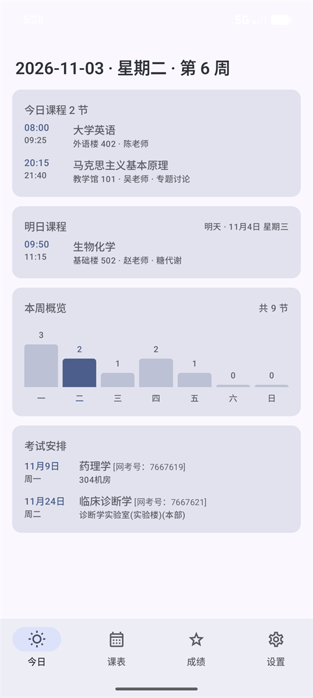
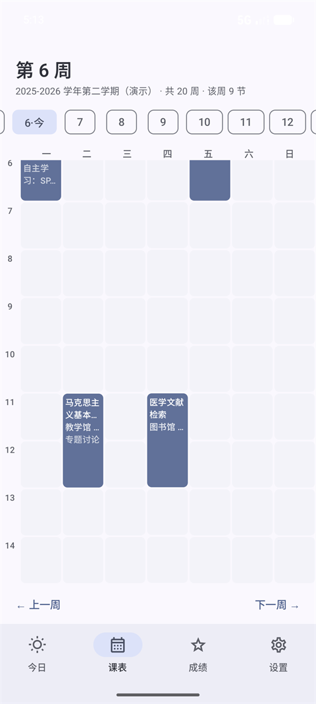
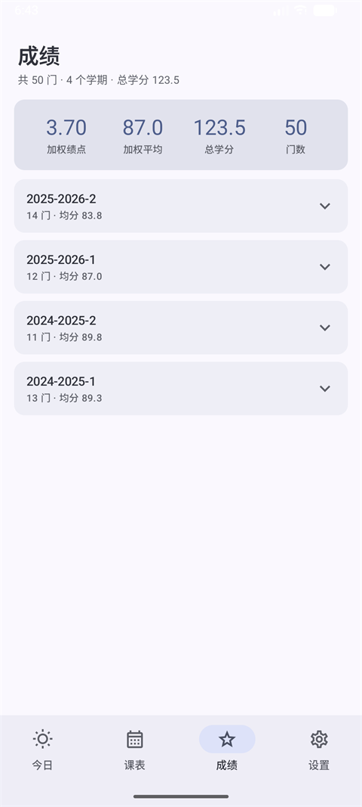

<div align="center">

# 南医大口袋 · SMU Pocket

南方医科大学学生自用的 Android 客户端

**课表 · 成绩 · 考试安排 · 离线可用**


</div>

> **非官方项目。** 与南方医科大学无任何隶属关系，未获学校授权或认可。
> 数据直连学校系统，不经过任何第三方服务器；**只读不写**，不做选课、缴费、评教提交等任何写操作。

---

## 功能

| 页面 | 能力 |
|---|---|
| **今日** | 日期标题 · 今日课程 · 明日课程 · 本周概览柱状图 · 考试安排 |
| **课表** | 按周切换 · 教务原生配色 · 跨节课程合并成整块 · 自主学习标注 |
| **成绩** | 按学期折叠 · 加权绩点 / 加权平均 / 总学分 / 门数 |
| **设置** | 手动同步 · 接入状态 · 自动缓存与过期提示 |

### 细节

- **扫码登录** —— 在 WebView 里打开学校登录页，用户自己扫码；App 不接触密码，只接管登录成功后的 cookie
- **今日与课表解耦** —— 在课表翻到第 8 周，「今日」仍然是**真实当前周**的课
- **明日课程** —— 自动处理跨周（今天是周日时，明天属于下一周，会单独拉取）
- **自主学习** —— 教务 `jxhjmc` 为「自主学习」的课打绿色标签，教室显示为「无需前往教室」
- **考试安排** —— 从整学期总表提取考试，自动过滤已过期，按日期升序
- **离线可用** —— 每次加载成功后缓存课表与成绩；登录过期时继续显示缓存，设置页可手动同步

---

## 截图

<!--
  把图片放到 docs/screenshots/ 下，然后把下面的 HTML 注释整体删掉即可显示。
  文件名与 docs/screenshots/README.md 里一致。
  建议用演示数据截图，避免真实课程/教师/学号进仓库。
-->

| 今日 | 课表 | 成绩 |
|:---:|:---:|:---:|
| 📷 `docs/screenshots/today.png` | 📷 `docs/screenshots/schedule.png` | 📷 `docs/screenshots/grades.png` |

| 考试安排 | 设置 |
|:---:|:---:|
| 📷 `docs/screenshots/exams.png` | 📷 `docs/screenshots/settings.png` |

<!--
图片就位后，把上面的表格换成：

<div align="center">



</div>
-->

---

## 技术栈

| 层 | 选型 | 说明 |
|---|---|---|
| 语言 | **Kotlin 2.0.21** | 协程 + 扩展函数 |
| UI | **Jetpack Compose** (BOM 2024.12.01) | Material3，无 XML 布局 |
| 状态 | `ViewModel` + `StateFlow` | 单一 `AppViewModel` 持有全部状态 |
| 网络 | **OkHttp 4.12** + **Retrofit 2.11** | 响应统一用 `ResponseBody` 接，手动解析 |
| 序列化 | **kotlinx.serialization 1.7.3** | 自定义 `FlexibleStringSerializer` 兼容类型漂移 |
| 登录 | `WebView` + `CookieManager` | 不接触密码，只采集 cookie |
| 构建 | Gradle 8.9 · AGP 8.7.3 · JDK 17 | `compileSdk 35` / `minSdk 26` / `targetSdk 35` |
| 压缩 | **R8**（`isMinifyEnabled = true`） | debug 16.7 MB → release **1.5 MB** |
| 测试 | JUnit 4 | **45 个单测**，跑夹具不需网络 |

**刻意的取舍**：不引 Hilt/Koin、不引 Room、不引 Navigation 库。整个 App 就两三个对象，
手写容器（`AppContainer`）比引框架便宜；接口改版时只改 `data/model/Mappers.kt` 一个文件。

---

## 快速开始

### 环境要求

- **JDK 17**（AGP 8.7 不支持 JDK 21+，用 25 会直接报错）
- **Android SDK Platform 35** + Build-Tools 35
- Android Studio Ladybug 及以上（可选，命令行也能构建）

### 1. 克隆

```bash
git clone https://github.com/1812355417/smu-pocket.git
cd smu-pocket
```

### 2. 指向你的 SDK

根目录建 `local.properties`（已在 `.gitignore` 里，不会提交）：

```properties
sdk.dir=C\:\\Users\\你的用户名\\AppData\\Local\\Android\\Sdk
```

> macOS / Linux 写 `sdk.dir=/Users/你的用户名/Library/Android/sdk`

### 3. ⚠️ 删掉机器相关的 JDK 路径

`gradle.properties` 里有一行：

```properties
org.gradle.java.home=C:/path/to/your/jdk-17
```

**这是原作者机器上的绝对路径，你必须删掉或改成自己的**，否则构建会失败（路径不存在）。

删掉后如果 Android Studio 报 JDK 版本错误，说明它在用自带的 JBR：
去 `Settings → Build, Execution, Deployment → Build Tools → Gradle → Gradle JDK`，选一个 **17**。

### 4. 构建

```bash
# 单元测试（不需要真机，45 个用例）
./gradlew testDebugUnitTest

# 调试包 → app/build/outputs/apk/debug/app-debug.apk
./gradlew assembleDebug

# 未签名的 release 包（已开 R8）→ app/build/outputs/apk/release/
./gradlew assembleRelease
```

Windows 用 `gradlew.bat`。首次构建会从**腾讯云镜像**下载 Gradle 8.9。

> 也可以直接 `git clone` 后用 Android Studio `File → Open` 打开，它会自动补全 SDK 与 Gradle。

### 5. 安装

```bash
adb install -r app/build/outputs/apk/debug/app-debug.apk
```

或者把 APK 传到手机点击安装（需允许「未知来源」）。

### 6. 打签名包（发给别人）

1. `Build → Generate Signed Bundle / APK...`
2. 选 **APK**（不是 Bundle）
3. `Create new...` 生成 keystore，**放在项目目录之外**并妥善备份
4. 选 `release` 变体 → Finish
5. 产物在 `app/release/app-release.apk`

> **keystore 丢了就永远无法给已安装用户推送更新**，这是 Android 签名的硬规则。
> 换签名后的包必须让用户卸载重装。

也可以让 Gradle 代签（`keystore.properties` 已在 `.gitignore`）：

```properties
storeFile=C:/path/to/your.jks
storePassword=******
keyAlias=your_alias
keyPassword=******
```

---

## 项目结构

```
smu-pocket/
├─ app/src/main/java/com/smu/pocket/
│  ├─ App.kt             手写依赖容器
│  ├─ MainActivity.kt    Compose 入口
│  ├─ core/              领域模型、时间/周次工具、会话与缓存
│  │  ├─ Models.kt       Course / Grade / TimetableConfig
│  │  ├─ TimeUtils.kt    周次换算、日期推算、节次解析
│  │  ├─ Semester.kt     第一周周一 → 第几周
│  │  ├─ Session.kt      cookie 按 host 持久化
│  │  └─ CacheStore.kt   课表/成绩/考试的本地快照
│  ├─ data/              教务接口
│  │  ├─ JwApi.kt        Retrofit 接口定义
│  │  ├─ RealJw.kt       真实实现：自举 + 按周拉取 + 分页成绩
│  │  └─ model/          JSON 模型、柔性序列化器、映射
│  └─ ui/                今日 / 课表 / 成绩 / 设置 / 登录
├─ app/src/test/         45 个单测 + 4 份脱敏夹具
├─ docs/
│  ├─ architecture.md    架构与关键机制
│  ├─ capture-checklist.md  抓包清单（接口调研的起点）
│  └─ screenshots/       截图（待补充）
└─ smu-probe/            教务 / 电费接口规格、字段字典
```

---

## 几个关键设计

### 登录为什么放在 WebView 里

`LoginScreen` 只做一件事：打开学校自己的登录页，用户自己扫码，App 只接管登录成功后的 cookie。

换来的好处：**验证码、密码前端加密、统一身份认证多跳、扫码登录**全部免适配。
反面做法是在 App 里 POST 登录表单 —— 学校一改加密方式就得重写。

判定登录成功不看 URL，而是**拿当前 cookie 真打一个轻量接口**（`zc=1`）：

```kotlin
override suspend fun probeSession(): Boolean {
    val body = requestBody { api.timetable(term = term, zc = "1") }
    return JwJson.timetable(body).code == 0
}
```

### 课表按周拉，不按学期拉

教务的 `zc` 参数就是「第几周」：`zc=9` 返回第 9 周的课，`zc=` 空返回整学期总表。
所以切周是**真的发一次请求**，而不是本地过滤 —— 也因此需要处理「切周时旧响应覆盖新响应」的竞态（用 `Job.cancel()`）。

### 考试日期是算出来的

整学期总表里**没有 `qsrq` 字段**（只有按周查询才有）。但考试行带有 `zc`（单周）和 `xq`（星期几），
所以用第一周周一推算：

```kotlin
fun dateOf(firstMonday: LocalDate, week: Int, dayOfWeek: Int): LocalDate =
    firstMonday.plusWeeks((week - 1).toLong()).plusDays((dayOfWeek - 1).toLong())
```

### 会话过期不弹窗，静默降级

教务的 `JSESSIONID` 是会话 cookie，闲置约半小时到两小时失效，而且**同账号在别处登录会把这边踢下线**。

现在的策略：有缓存就继续显示缓存，不打断用户；只有在设置页手动点「同步」且失败时，才退回登录页。

---

## 已知限制

| 限制 | 说明 |
|---|---|
| **不支持电费查询** | 宿舍电费走微信公众号 OAuth（openid），WebView 拿不到；详见 `smu-probe/电费接口规格.md` |
| **只读** | 不提供选课、缴费、评教等写操作 |
| **学期靠推算** | 教务没有查当前学期的接口（页面下拉只有全量列表、无 selected 标记），改为「缓存 → 日期推算 → 常量」纯本地解析，新学期无需改代码 |
| **作息时间本地写死** | 教务不提供每节课的起止时间接口，`DEFAULT_PERIODS` 是手工维护的 |
| **必须扫码登录** | 密码登录有极验滑块验证，不做绕过 |

---

## 数据与隐私

- 账号密码**只在学校的登录页输入**，App 不接触、不保存、不上传
- 登录态（cookie）存在应用私有目录，按 host 分开
- 本地缓存只包含**课表、成绩、考试**，不含姓名和学号
- 所有请求直连 `zhjw.smu.edu.cn`，没有任何第三方服务器
- 仓库里的测试夹具已脱敏（学号替换为 `2023000001`）

---

## 免责声明

- 本项目仅供**学习交流与个人使用**，请勿用于商业用途
- 请遵守学校信息系统的使用规定，**不要高频请求**
- 不提供任何写操作，涉及选课/缴费/评教的功能只做跳转
- 因使用本软件产生的任何后果由使用者自行承担

---

## 参考

- 交互与抓包思路参考 [Hello-Minecraft/gzucm-pocket](https://github.com/Hello-Minecraft/gzucm-pocket)（广州中医药大学口袋）
